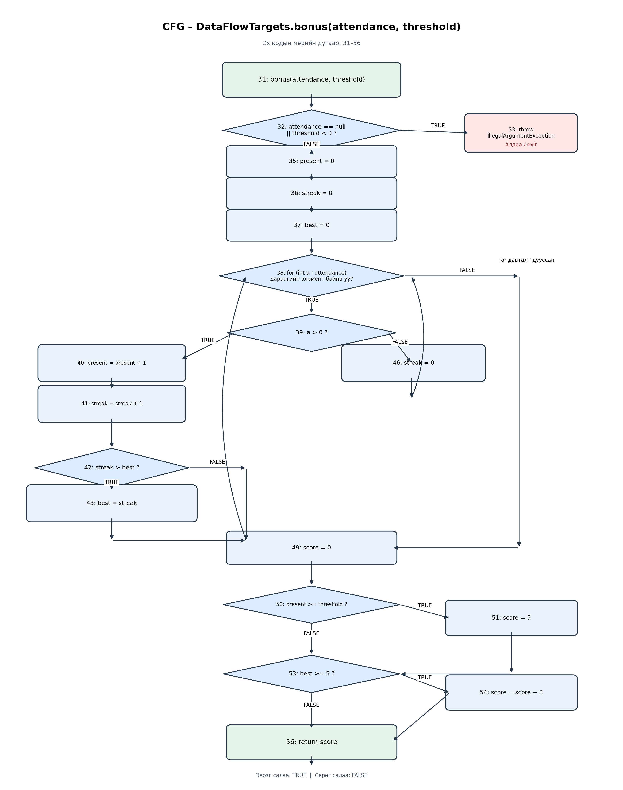

# Lab 10 – Dataflow Testing

## 1. Оюутны мэдээлэл

- **Оюутны нэр:** Эрдэнэтунгалаг
- **Оюутны код:** B232270157
- **Хичээл:** F.CSA313
- **Лаборатори:** Lab 10 – Dataflow Testing

## 2. Орчны мэдээлэл

Энэ лабораторийн ажлыг Java болон Maven ашиглан гүйцэтгэсэн.

### Java хувилбар

```text
java version "26" 2026-03-17
Java(TM) SE Runtime Environment (build 26+35-2893)
Java HotSpot(TM) 64-Bit Server VM (build 26+35-2893, mixed mode, sharing)
```

### Maven хувилбар

```text
Apache Maven 3.9.10
Maven home: C:\Program Files\Apache\Maven\apache-maven-3.9.10
Java version: 26, vendor: Oracle Corporation
OS name: Windows 11, version: 10.0, arch: amd64
```

### Ашигласан технологи

- Java 26
- Apache Maven 3.9.10
- JUnit 5.10.2
- JaCoCo 0.8.16
- Windows 11

## 3. Part A – GCD функцийн өгөгдлийн урсгалын шинжилгээ

`DataFlowTargets.java` файлын `gcd(x, y)` функцэд all-DU-pairs шинжилгээ хийсэн. Хувьсагчийн утга оноосон мөрийг Definition (Def), тооцоололд ашигласан мөрийг c-use, нөхцөл шалгахад ашигласан мөрийг p-use гэж үзсэн.

### DU хосуудын хүснэгт

| ID | Хувьсагч | Definition | Use | Төрөл | Тест |
|---|---|---:|---|---|---|
| G1 | x | 13 | 16 | c-use | G-T1 |
| G2 | x | 13 | 20 | c-use | G-T2 |
| G3 | x | 17 | 16 | c-use | G-T1 |
| G4 | x | 17 | 20 | c-use | G-T1 |
| G5 | y | 13 | 15 TRUE | p-use | G-T1 |
| G6 | y | 13 | 15 FALSE | p-use | G-T2 |
| G7 | y | 13 | 16 | c-use | G-T1 |
| G8 | y | 13 | 17 | c-use | G-T1 |
| G9 | y | 18 | 15 TRUE | p-use | G-T1 |
| G10 | y | 18 | 15 FALSE | p-use | G-T1 |
| G11 | y | 18 | 16 | c-use | G-T1 |
| G12 | y | 18 | 17 | c-use | G-T1 |
| G13 | tmp | 16 | 18 | c-use | G-T1 |

### Тестийн тайлбар

- **G-T1: `gcd(12, 8)`** – Хоёр давталт ажиллуулж, давталтын доторх DU хосуудыг шалгасан.
- **G-T2: `gcd(7, 0)`** – Давталт алгасагдах үеийн DU хосуудыг шалгасан.
- **G-T3: `gcd(0, 5)`** – Нэг давталт ажиллах нэмэлт тест.

## 4. Part B – Bonus функцийн өгөгдлийн урсгалын шинжилгээ
CFG график



Definition болон Use
Хувьсагч	Definition	c-use	p-use
attendance	31	–	32, 38
threshold	31	–	32, 50
present	35, 40	40	50
streak	36, 41, 46	41, 43	42
best	37, 43	–	42, 53
a	38	–	39
score	49, 51, 54	54, 56	–

DU хосуудын хүснэгт
ID	Хувьсагч	Definition	Use	Төрөл	Тест
B1	attendance	31	32 TRUE	p-use	B-T3
B2	attendance	31	32 FALSE	p-use	B-T1
B3	attendance	31	38 TRUE	p-use	B-T1
B4	attendance	31	38 FALSE	p-use	B-T2
B5	threshold	31	32 TRUE	p-use	B-T4
B6	threshold	31	32 FALSE	p-use	B-T1
B7	threshold	31	50 TRUE	p-use	B-T1
B8	threshold	31	50 FALSE	p-use	B-T6
B9	present	35	40	c-use	B-T1
B10	present	40	40	c-use	B-T1
B11	present	35	50 TRUE	p-use	B-T5
B12	present	35	50 FALSE	p-use	B-T2
B13	present	40	50 TRUE	p-use	B-T1
B14	present	40	50 FALSE	p-use	B-T6
B15	streak	36	41	c-use	B-T1
B16	streak	41	41	c-use	B-T1
B17	streak	46	41	c-use	B-T1
B18	streak	41	42 TRUE	p-use	B-T1
B19	streak	41	42 FALSE	p-use	B-T1
B20	streak	41	43	c-use	B-T1
B21	best	37	42 TRUE	p-use	B-T1
B22	best	43	42 FALSE	p-use	B-T1
B23	best	37	53 FALSE	p-use	B-T2
B24	best	43	53 TRUE	p-use	B-T1
B25	best	43	53 FALSE	p-use	B-T6
B26	a	38	39 TRUE	p-use	B-T1
B27	a	38	39 FALSE	p-use	B-T1
B28	score	49	54	c-use	B-T7
B29	score	49	56	c-use	B-T2
B30	score	51	54	c-use	B-T1
B31	score	51	56	c-use	B-T8
B32	score	54	56	c-use	B-T1

DU хосуудын тайлбар
- attendance: 32-р мөрөнд null эсэх, 38-р мөрөнд массивын давталт үргэлжлэх эсэхийг шалгана.
- threshold: 32-р мөрөнд сөрөг утгатай эсэх, 50-р мөрөнд ирцийн босгыг хангасан эсэхийг шалгана.
- present: 35-р мөрөнд эхний утгыг 0 болгож, 40-р мөрөнд ирсэн өдрийг тоолно. Давталтын дараа 50-р мөрөнд ашиглана.
- streak: 36-р мөрөнд эхэлж 0 болно. 41-р мөрөнд нэмэгдэж, 46-р мөрөнд тасалдсан үед дахин 0 болно.
- best: 37-р мөрөнд эхэлж 0 болно. 43-р мөрөнд хамгийн урт дарааллын утгаар шинэчлэгдэнэ.
- a: 38-р мөрөнд массивын элемент бүрийг авч, 39-р мөрөнд ирсэн эсэхийг шалгана.
- score: 49-р мөрөнд 0 болж, 51-р мөрөнд 5 оноо авах эсвэл 54-р мөрөнд 3 оноо нэмэх боломжтой. .

## 5. Part C – Fault Injection

Mutation testing ашиглан програмын кодод зориудаар өөрчлөлт оруулж, тестүүд алдааг илрүүлж байгаа эсэхийг шалгасан.

### M1 – Missing Update

`streak = streak + 1` үйлдлийг устгаж туршсан.

- Нийт 11 тест ажилласан.
- 2 тест амжилтгүй болсон.
- `allDefsA` болон `longStreakBelowThreshold` тестүүд алдааг илрүүлсэн.
- M1 mutation **killed** болсон.

### M2 – Wrong Variable

`best = streak` мөрийг `best = present` болгон өөрчилсөн.

- Эхний 8 Bonus тест болон 3 GCD тест амжилттай ажилласан.
- Анхны тестүүд M2 алдааг илрүүлээгүй буюу **survived** болсон.
- B-T9 нэмэлт тест зохиосны дараа алдаа илэрсэн.
- Нийт 12 тестээс 1 тест амжилтгүй болсон.
- M2 mutation **killed** болсон.

### M3 – Dead Definition

Ашиглагдахгүй `total` хувьсагч нэмсэн.

- Нийт 12 тест амжилттай ажилласан.
- Тестүүд өөрчлөлтийг илрүүлээгүй буюу **survived** болсон.
- IDE дээр `Variable total is never read` гэсэн анхааруулга гарсан.
- Энэ нь хувьсагчид утга оноосон боловч дараа нь ашиглаагүй байгааг илэрхийлнэ.
- Ийм төрлийн асуудлыг static analysis ашиглан илрүүлэх боломжтой.

## 6. JaCoCo Coverage

JaCoCo ашиглан тестийн хамрах хүрээг хэмжсэн.

### All-defs үе шат

| Үзүүлэлт | Хамрагдсан | Нийт | Хувь |
|---|---:|---:|---:|
| Instruction | 73 | 81 | 90.1% |
| Branch | 14 | 16 | 87.5% |
| Line | 22 | 24 | 91.7% |

### Эцсийн үр дүн

| Үзүүлэлт | Хамрагдсан | Нийт | Хувь |
|---|---:|---:|---:|
| Instruction | 78 | 81 | 96.3% |
| Branch | 16 | 16 | 100% |
| Line | 23 | 24 | 95.8% |
| Complexity | 10 | 11 | – |
| Method | 2 | 3 | – |
| Class | 1 | 1 | 100% |

- JaCoCo хувилбар: 0.8.16
- Эцсийн branch coverage: **100%**
- Хамрагдаагүй нэг мөр нь автоматаар үүсдэг default constructor-той холбоотой.

Branch coverage 100% болсон нь бүх шийдвэрийн салааг тестээр ажиллуулсан гэсэн үг. Гэхдээ энэ нь бүх DU хос хамрагдсан гэсэн үг биш юм. Учир нь branch coverage нь нөхцөлийн салааллыг хэмждэг бол dataflow testing нь хувьсагчийн Definition болон Use-ийн хоорондох замыг шалгадаг.

### Үр дүнгийн файлууд

Тест болон JaCoCo-ийн үр дүнг `results/` хавтсанд хадгалсан.

- `jacoco-alldefs.csv`
- `jacoco-final.csv`
- `mvn-test-final.txt`
- `mvn-verify-alldefs.txt`
- `mvn-verify-final.txt`
- `mvn-test-M1.txt`
- `mvn-test-M2.txt`
- `mvn-test-M2-kill.txt`
- `mvn-test-M3.txt`

## 7. Дүгнэлт

Энэ лабораторийн ажлаар өгөгдлийн урсгалын шинжилгээ болон DU хосын тестийн талаар судалж, практикт хэрэгжүүллээ. GCD функцэд all-DU-pairs тест зохиож, хувьсагчийн Definition болон Use-ийн хамаарлыг шалгасан. Bonus функцэд эхлээд all-defs тест, дараа нь all-DU-pairs тест нэмсэн.

JaCoCo ашиглан тестийн хамрах хүрээг хэмжихэд эцсийн branch coverage 100% болсон. Mutation testing хийхэд M1 болон M2 алдааг тестүүд илрүүлсэн бол M3 өөрчлөлт тестүүдэд илрээгүй. M2 алдааг илрүүлэхийн тулд B-T9 нэмэлт тест зохиосон.

Энэ ажлаас branch coverage өндөр байх нь бүх өгөгдлийн урсгалын хосыг шалгасан гэсэн үг биш гэдгийг ойлгосон. Мөн тестийн чанарыг шалгахад mutation testing чухал ач холбогдолтойг мэдэж авлаа.

